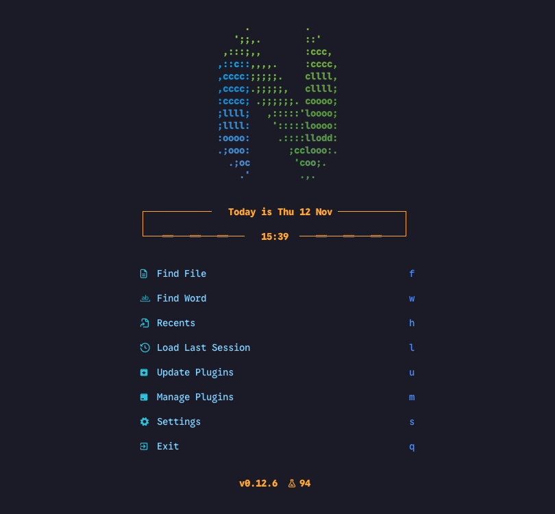

# Frontend Neovim Config

For **Neovim 0.12+**. Free to use, modify and share under the GPL-3.0 license (see [LICENSE](./LICENSE)).

### A non-minimal Neovim config built for frontend development (TypeScript, React, Angular, Vue, Tailwind).

## ✨ Features

<table>
<tr>
<td valign="top" width="33%">

### 🤖 AI & Assistance
- [Avante](https://github.com/yetone/avante.nvim) - AI coding assistant (Copilot, Claude Code and LM Studio providers)
- [copilot-lsp](https://github.com/copilotlsp-nvim/copilot-lsp) - Copilot Next Edit Suggestions
- [blink-copilot](https://github.com/fang2hou/blink-copilot) - Copilot suggestions in the completion menu
- [MCPHub](https://github.com/ravitemer/mcphub.nvim) - MCP servers for Avante
- [Opencode](https://github.com/sudo-tee/opencode.nvim) - optional, toggled with `Nvim.plugins.ai.opencode.enabled`

</td>
<td valign="top" width="33%">

### 🎨 UI & Experience
- [Tokyonight](https://github.com/folke/tokyonight.nvim) theme ([Catppuccin](https://github.com/catppuccin/nvim) also installed)
- Hand-written statusline and winbar with [navic](https://github.com/SmiteshP/nvim-navic) breadcrumbs (`lua/internal/`)
- [Snacks.nvim](https://github.com/folke/snacks.nvim) - dashboard, picker, explorer, notifications, terminal, zen
- [noice](https://github.com/folke/noice.nvim) - cmdline, messages and LSP progress
- [bufferline](https://github.com/akinsho/bufferline.nvim) - buffer tabs
- [which-key](https://github.com/folke/which-key.nvim) - keybinding helper
- [nvim-ufo](https://github.com/kevinhwang91/nvim-ufo) - folds with peek
- [tiny-inline-diagnostic](https://github.com/rachartier/tiny-inline-diagnostic.nvim), [tiny-glimmer](https://github.com/rachartier/tiny-glimmer.nvim), [todo-comments](https://github.com/folke/todo-comments.nvim), [rainbow-delimiters](https://github.com/HiPhish/rainbow-delimiters.nvim), [nvim-highlight-colors](https://github.com/brenoprata10/nvim-highlight-colors)

</td>
<td valign="top" width="33%">

### 💻 Frontend Development
- TypeScript with `ts_ls` (default) or `tsgo`
- React / Next.js, Angular (with a version check for the Angular language server), Vue (TypeScript through `ts_ls`)
- Tailwind CSS: language server, [tw-values](https://github.com/MaximilianLloyd/tw-values.nvim), [tailwind-fold](https://github.com/razak17/tailwind-fold.nvim), [tailwindcss-dial](https://github.com/ruicsh/tailwindcss-dial.nvim)
- CSS / SCSS ([Some Sass](https://github.com/wkillerud/some-sass)), HTML, Emmet, GraphQL, Prisma, Deno
- [blink.cmp](https://github.com/Saghen/blink.cmp) completion with [LuaSnip](https://github.com/L3MON4D3/LuaSnip) snippets
- [package-info](https://github.com/vuki656/package-info.nvim) - npm versions in `package.json`
- [Vitest](https://vitest.dev/) through [neotest](https://github.com/nvim-neotest/neotest) (Angular `ng test` aware) and [coverage](https://github.com/andythigpen/nvim-coverage)

</td>
</tr>
<tr>
<td valign="top" width="33%">

### 🔧 DevOps & Tools
- Docker, Terraform (+ tflint), YAML, Bash, SQL and Markdown language servers
- [nvim-sops](https://github.com/prismatic-koi/nvim-sops) - edit SOPS-encrypted files
- [yazi.nvim](https://github.com/mikavilpas/yazi.nvim) - terminal file manager
- [harpoon](https://github.com/ThePrimeagen/harpoon) - quick file navigation
- [multicursor](https://github.com/jake-stewart/multicursor.nvim) - multi-cursor editing
- [smart-splits](https://github.com/mrjones2014/smart-splits.nvim) - split navigation and resizing
- Monorepo-aware root detection (pnpm, Turborepo, Nx, Lerna, Rush)

</td>
<td valign="top" width="33%">

### 🔍 Code Quality
- Native LSP (`vim.lsp.config`) with servers installed by [mason.nvim](https://github.com/mason-org/mason.nvim)
- [conform.nvim](https://github.com/stevearc/conform.nvim) formatting, optional format on save
- [nvim-lint](https://github.com/mfussenegger/nvim-lint) on open and save (eslint_d, oxlint, biome, pylint, hadolint, tflint)
- [SchemaStore](https://github.com/b0o/SchemaStore.nvim) - JSON/YAML schemas
- [inc-rename](https://github.com/smjonas/inc-rename.nvim), [symbol-usage](https://github.com/Wansmer/symbol-usage.nvim), [lazydev](https://github.com/folke/lazydev.nvim)
- [grug-far](https://github.com/MagicDuck/grug-far.nvim) - search & replace (also ast-grep)
- [treesj](https://github.com/Wansmer/treesj), [mini.ai](https://github.com/nvim-mini/mini.ai), [mini.align](https://github.com/nvim-mini/mini.align), [nvim-surround](https://github.com/kylechui/nvim-surround), [flash](https://github.com/folke/flash.nvim), [text-case](https://github.com/johmsalas/text-case.nvim), [scissors](https://github.com/chrisgrieser/nvim-scissors), [comment-box](https://github.com/LudoPinelli/comment-box.nvim)

</td>
<td valign="top" width="33%">

### 🌳 Git Integration
- [Lazygit](https://github.com/jesseduffield/lazygit) through Snacks
- [gitsigns](https://github.com/lewis6991/gitsigns.nvim) - hunks, inline blame, signs against the index or the last commit
- [diffview-plus](https://github.com/dlyongemallo/diffview-plus.nvim) - diff viewer and file history
- [octo.nvim](https://github.com/pwntester/octo.nvim) - GitHub PRs & issues
- [gitlinker](https://github.com/linrongbin16/gitlinker.nvim) - copy links to lines
- [blame.nvim](https://github.com/FabijanZulj/blame.nvim) - blame panel

</td>
</tr>
</table>

### 📘 TypeScript & React Features

| Feature | Plugin / server | Description |
|---------|-----------------|-------------|
| **TypeScript server** | `ts_ls` or `tsgo` | Pick with `Nvim.lsp.typescript_server`; `ts_ls` also serves TypeScript in `.vue` files |
| **Import actions** | `ts_ls` | Organize imports, add missing imports, remove unused code, fix all (`SPC c o/i/u/F`) |
| **Type checking** | [tsc.nvim](https://github.com/dmmulroy/tsc.nvim) | Async project-wide `tsc --noEmit` with quickfix (`SPC c e`) |
| **Error translation** | [ts-error-translator](https://github.com/dmmulroy/ts-error-translator.nvim) | Human-readable TypeScript errors |
| **Linting** | eslint, oxlint, biome | Language servers, plus nvim-lint where a server isn't running |
| **RSC boundaries** | [boundary.nvim](https://github.com/kenzo-pj/boundary.nvim) | Show `'use client'` component boundaries in Next.js |
| **Template strings** | [template-string](https://github.com/axelvc/template-string.nvim) | Turn quotes into backticks when you type `${}` |
| **Auto tags** | [nvim-ts-autotag](https://github.com/windwp/nvim-ts-autotag) | Close and rename JSX / HTML tags |
| **Tailwind** | tailwindcss LS, tw-values, tailwind-fold | Class completion and colors, resolved values, fold long class strings |
| **Smart increment** | [dial.nvim](https://github.com/monaqa/dial.nvim) | Numbers, dates, booleans, `&&`/`\|\|`, Tailwind classes |
| **Reference counts** | [symbol-usage](https://github.com/Wansmer/symbol-usage.nvim) | Usage counts above functions and components |
| **Live rename** | [inc-rename](https://github.com/smjonas/inc-rename.nvim) | Preview LSP rename as you type |
| **JSON/YAML schemas** | [SchemaStore](https://github.com/b0o/SchemaStore.nvim) | Schemas for `tsconfig.json`, `package.json` and more |
| **Testing** | neotest-vitest | Run nearest / file / last test, output and summary |

### 🚀 Performance
- **Startup time:** about 80-120 ms to the dashboard and about 150 ms when opening a file (Apple M5 Pro, measured with `require("lazy").stats()`)
- **Lazy loading:** 43 of 94 plugins load at startup; the rest load on events, commands, filetypes or keys through [lazy.nvim](https://github.com/folke/lazy.nvim)

## Screenshots

Dashboard



## Installation

**Prerequisites**

- Neovim **0.12** or newer.
- git, make and a C compiler (LuaSnip's regex support and treesitter parsers are built locally).
- The [tree-sitter CLI](https://github.com/tree-sitter/tree-sitter), required by nvim-treesitter's `main` branch to install parsers.
- Node.js and npm (most language servers and formatters, Copilot), and Python 3 with pip (black, isort, pylint).
- curl, unzip and tar for Mason; ripgrep and fd for the pickers; [lazygit](https://github.com/jesseduffield/lazygit) and [yazi](https://github.com/sxyazi/yazi) for their keymaps.
- A [Nerd Font](https://www.nerdfonts.com/font-downloads).

On macOS: `brew install neovim git ripgrep fd tree-sitter-cli lazygit yazi node python`.

**Install**

```bash
git clone https://github.com/vlabunets/nvim ~/.config/nvim
nvim
```

On the first start lazy.nvim installs the plugins, Mason installs the language servers, and nvim-treesitter installs the parsers listed in `lua/plugins/treesitter.lua`. Restart Neovim once it finishes.

**After installing**

1. Install the formatters and linters you use from `:Mason` (for example prettierd, prettier, stylua, black, isort, eslint_d); Mason installs only the language servers automatically.
2. Run `:checkhealth` to find missing tools. `:checkhealth nvim-treesitter` lists the installed parsers.
3. Optionally create `lua/config/user.lua` for personal settings (see below).

## Configuration

Personal settings go in `lua/config/user.lua`. The file is **gitignored**, so `git pull` never conflicts with it. Defaults live in `lua/config/nvim.lua` on the global `Nvim` table; `user.lua` loads after it and overrides them.

### Quick Start

```bash
# Copy the example file
cp lua/config/user.lua.example lua/config/user.lua

# Edit your personal config
nvim lua/config/user.lua
```

### Quick Customization Examples

```lua
-- lua/config/user.lua

-- Change colorscheme
Nvim.colorscheme = "tokyonight-storm"

-- Install more LSP servers with Mason
Nvim.lsp.ensure_installed = { "rust_analyzer", "gopls" }

-- Override formatters
Nvim.formatters = {
  javascript = { "prettierd" },
  typescript = { "prettierd" },
}

-- Override linters (nvim-lint names, e.g. "biomejs", not "biome").
-- eslint_d and biomejs only run when the project has an eslint / biome config.
Nvim.linters = {
  typescript = { "eslint_d", "biomejs" },
  html = { "eslint_d" }, -- Angular templates
}

-- Add custom autocmds
Nvim.autocmds.auto_save = {
  event = "FocusLost",
  pattern = "*",
  command = "silent! wa",
}

-- Override any plugin config (use repo name, e.g., "snacks.nvim")
Nvim.plugin_overrides["snacks.nvim"] = function(_, opts)
  opts.picker.layout = "vertical"
end

-- Configure project directories (for <leader>pl project picker)
Nvim.plugins.projects.dev = { "~/Projects", "~/Work" }

-- Add package.json back to rooter if you don't use monorepos
-- Nvim.plugins.rooter.patterns = { ".git", "package.json" }

-- Toggle features on/off
Nvim.lsp.format_on_save = true           -- Enable auto-format on save
Nvim.lsp.inlay_hints = false             -- Disable inlay hints
Nvim.lsp.typescript_server = "tsgo"      -- Switch from ts_ls to tsgo
Nvim.plugins.ai.copilot.enabled = false  -- Disable Copilot (NES and completion source)
Nvim.plugins.completion.ghost_text = false  -- Disable ghost text
Nvim.plugins.git.blame_line = false      -- Disable inline git blame

-- Custom vim options
vim.opt.tabstop = 4
vim.opt.shiftwidth = 4
```

### Full Configuration Options

| Option | Type | Default | Description |
|--------|------|---------|-------------|
| `colorscheme` | string | `"tokyonight-night"` | Theme name |
| `ui.float.border` | string | `"rounded"` | Border for floating windows: `"rounded"`, `"single"`, `"double"`, `"shadow"`, `"none"` |
| `lsp.typescript_server` | string | `"ts_ls"` | TypeScript server: `"ts_ls"` (classic) or `"tsgo"` (fast, native; no Vue support) |
| `lsp.ensure_installed` | table | `{}` | Extra LSP servers for Mason to install and enable |
| `lsp.exclude` | table | `{ "copilot" }` | Installed servers that should not be enabled automatically |
| `lsp.servers` | table | `{}` | Extra `vim.lsp.config` settings per server, e.g. `{ rust_analyzer = { settings = { … } } }` |
| `lsp.format_on_save` | boolean | `false` | Format on save (toggle at runtime with `:LspToggleAutoFormat` / `SPC c t`) |
| `lsp.inlay_hints` | boolean | `true` | Show inlay hints from LSP servers |
| `formatters` | table | `{}` | Formatters per filetype, merged over the defaults in `lua/plugins/formatting.lua` |
| `linters` | table | `{}` | Linters per filetype (nvim-lint names), merged over the defaults in `lua/plugins/linting.lua` |
| `autocmds` | table | `{}` | Extra autocmds: `{ name = { event, pattern?, command? or callback? } }` |
| `plugin_overrides` | table | `{}` | Override a plugin's `opts`, keyed by repo name (table is deep-merged, function receives `(plugin, opts)`) |
| `plugins.ai.avante.enabled` | boolean | `true` | Enable Avante |
| `plugins.ai.copilot.enabled` | boolean | `true` | Enable Copilot NES and the Copilot completion source |
| `plugins.ai.opencode.enabled` | boolean | `true` | Enable Opencode |
| `plugins.completion.ghost_text` | boolean | `true` | Show the inline completion preview (ghost text) |
| `plugins.git.blame_line` | boolean | `true` | Show inline git blame on the current line |
| `plugins.jump_by_subwords.enabled` | boolean | `false` | Move `w`/`e`/`b` by camelCase / snake_case subwords ([nvim-spider](https://github.com/chrisgrieser/nvim-spider)) |
| `plugins.rooter.patterns` | table | monorepo markers, `.git`, … | Root detection patterns for vim-rooter |
| `plugins.projects.dev` | table | `{ "~/Projects", "~/.config" }` | Directories to scan for projects |
| `plugins.projects.patterns` | table | `{ ".git" }` | Patterns that mark a project root |
| `statusline.path_enabled` | boolean | `false` | Show the file path in the statusline |
| `statusline.path` | string | `"relative"` | Path style: `"relative"` or `"absolute"` |

### Tips

- **Runtime toggles** -- `:LspToggleAutoFormat` (`SPC c t`) for format on save, `:Gitsigns toggle_current_line_blame` for inline blame.
- **Plugin overrides** change a plugin's `opts` without editing its spec. They don't apply to specs that use `config = function()` without `opts` (for example `formatting.lua`); use `Nvim.formatters` / `Nvim.linters` there.
- **Monorepos** -- pnpm/Turborepo/Nx/Lerna/Rush roots are detected automatically. `package.json` is left out of the rooter patterns so `cwd` doesn't jump into sub-packages.
- **Border style** -- `Nvim.ui.float.border` sets the border of all floating windows (hover, diagnostics, completion, signature help).
- See `lua/config/user.lua.example` for every option with comments.

### For vim settings and new plugins

- Edit `lua/config/options.lua` for vim options
- Create files in `lua/plugins/` for new plugins

### MCP servers (MCPHub)

[MCPHub](https://github.com/ravitemer/mcphub.nvim) gives Avante access to MCP servers. The servers are **not** configured in Lua. The `mcp-hub` process reads them from JSON files:

| File | Scope |
|------|-------|
| `~/.config/mcphub/servers.json` | Global, used in every project. Lives outside this repo, so tokens never end up in git. |
| `.mcphub/servers.json`, `.vscode/mcp.json` or `.cursor/mcp.json` in a project root | Per project. Merged on top of the global file and served by a separate hub on a port in 40000-41000. |

Example `~/.config/mcphub/servers.json`:

```jsonc
{
  "mcpServers": {
    // local (stdio) server
    "filesystem": {
      "command": "npx",
      "args": ["-y", "@modelcontextprotocol/server-filesystem", "${userHome}/projects"]
    },
    // remote server with a token taken from the gh CLI
    "github": {
      "url": "https://api.githubcopilot.com/mcp/",
      "headers": { "Authorization": "Bearer ${cmd: gh auth token}" }
    },
    // secret read from the macOS keychain:
    //   security add-generic-password -a "$USER" -s figma-api-key -w
    "figma": {
      "command": "npx",
      "args": ["-y", "figma-developer-mcp", "--stdio"],
      "env": { "FIGMA_API_KEY": "${cmd: security find-generic-password -s figma-api-key -w}" }
    }
  },
  // built-in servers; "neovim" duplicates Avante's own file/terminal tools
  "nativeMCPServers": {
    "neovim": { "disabled": true }
  }
}
```

The real file must be plain JSON, so leave out the comments.

- **Server fields.** Local servers use `command`, `args`, `env` and `cwd`. Remote servers use `url` and `headers`; mcp-hub tries streamable HTTP first and falls back to SSE.
- **Placeholders.** `${env:VAR}`, `${cmd: …}`, `${userHome}` and `${workspaceFolder}` work in every field. Don't paste tokens in as plain text.
- **Applying changes.** Edit the file, or use `:MCPHub` to add, toggle, authorize (OAuth) and restart servers. The hub watches the file and reloads it.
- **Environment variables.** The hub is a long-lived process shared by all Neovim instances and shuts down 5 minutes after the last one closes. It reads environment variables only when it starts, so restart it from `:MCPHub` after changing them.
- **Logs.** `~/.local/state/mcp-hub/logs/mcp-hub.log`
- **Not for `claude-code`.** Avante's `claude-code` provider runs Claude Code over ACP and doesn't see MCPHub servers. Claude Code loads its own MCP servers (`claude mcp add …` or `.mcp.json`).
- **Prompt size.** Every enabled server's tool list goes into each Avante request. Disable the servers you don't need to keep prompts small.

## Keybindings

Space (`SPC`) is the leader key and `,` the local leader.

> **Tip:** Press `SPC` in normal mode to open the which-key menu and explore all available keybindings interactively.

<details>
<summary>File Explorer (Snacks)</summary>

### File Explorer (Snacks)

| Key Bindings | Description                                |
|--------------|--------------------------------------------|
| `<C-e>`      | Toggle Snacks file explorer                |
| `<D-e>`      | Toggle Snacks file explorer (macOS Cmd+E)  |

The Snacks explorer uses its own keybindings when focused. Press `?` inside the explorer to see all available actions (create, rename, copy, delete, etc.).

</details>

<details>
<summary>Searching</summary>

### Searching

| Key Bindings | Description                        |
|--------------|------------------------------------|
| `<C-p>`      | Smart file finder (Snacks picker)  |
| `P`          | Live grep (Snacks picker)          |
| `s`          | Flash jump to any word             |
| `S`          | Flash treesitter selection         |
| `SPC s f`    | Find files                         |
| `SPC s b`    | Find buffers                       |
| `SPC s g`    | Git grep                           |
| `SPC s o`    | Grep open buffers                  |
| `SPC s h`    | Recent files                       |
| `SPC s H`    | Command history                    |
| `SPC s /`    | Search history                     |
| `SPC s q`    | Quickfix list                      |
| `SPC s c`    | Color schemes                      |
| `SPC s d`    | Search dotfiles (nvim config)      |
| `SPC s t`    | Search TODOs                       |
| `SPC s T`    | Search TODO/FIX/FIXME              |
| `]t`         | Next TODO comment                  |
| `[t`         | Previous TODO comment              |

</details>

<details>
<summary>Working with LSP</summary>

### Working with LSP

| Key Bindings           | Description                             |
|------------------------|-----------------------------------------|
| `gd`                   | Go to definition                        |
| `grr`                  | Go to references                        |
| `gy`                   | Go to type definition                   |
| `gi`                   | Go to implementation                    |
| `K`                    | Hover documentation / peek fold         |
| `L`                    | Signature help                          |
| `gl`                   | Line diagnostics                        |
| `]g`                   | Next diagnostic                         |
| `[g`                   | Previous diagnostic                     |
| `<C-Space>` / `SPC c a`| Code action                             |
| `SPC c f`              | Format document / selection (conform)   |
| `SPC c r`              | Rename symbol (live preview)            |
| `SPC c R`              | Rename file                             |
| `SPC c d`              | Diagnostics list (Snacks picker)        |
| `SPC c t`              | Toggle format on save                   |
| `SPC c U`              | Toggle symbol usage                     |
| `SPC c m`              | Mason LSP manager                       |
| `SPC c l i`            | LSP Info (`:checkhealth vim.lsp`)       |
| `SPC c l r`            | LSP Restart (`:lsp restart`)            |
| `SPC c l s`            | LSP Stop (`:lsp stop`)                  |
| `SPC c l S`            | LSP Start (`:lsp enable`)               |
| `SPC s s`              | Document symbols                        |
| `SPC s S`              | Workspace symbols                       |

</details>

<details>
<summary>TypeScript / React (buffer-local)</summary>

### TypeScript / React (buffer-local)

These keybindings are available in TypeScript/JavaScript buffers:

| Key Bindings | Description                          |
|--------------|--------------------------------------|
| `SPC c e`    | Workspace errors (TSC)               |
| `SPC c i`    | Add missing imports                  |
| `SPC c o`    | Organize imports                     |
| `SPC c u`    | Remove unused code (whole file)      |
| `SPC c F`    | Fix all (TS fixable issues)          |

Available everywhere:

| Key Bindings | Description                          |
|--------------|--------------------------------------|
| `SPC c v`    | Show resolved Tailwind CSS values    |
| `<C-a>` / `<C-x>` | Increment / decrement: numbers, dates, true/false, yes/no, on/off, enable/disable, `&&`/`\|\|`, Tailwind classes |

</details>

<details>
<summary>Formatting & Linting</summary>

### Formatting & Linting

| Key Bindings       | Description                              |
|--------------------|------------------------------------------|
| `SPC c f`          | Format file / selection (conform.nvim)   |
| `<C-s>`            | Format and save                          |
| `SPC l`            | Lint file (nvim-lint)                    |

SCSS and Less are formatted with prettier (project `.prettierrc` is respected). Linters also run on open and on save, except `eslint_d`, `oxlint` and `biomejs` when their language server is attached (it reports the same diagnostics). `eslint_d` and `biomejs` lint only when the project has an eslint / biome config; Angular templates (`*.html`) are linted with eslint.

</details>

<details>
<summary>Working with Git</summary>

### Working with Git

| Key Bindings | Description                                                             |
|--------------|-------------------------------------------------------------------------|
| `SPC g g`    | Lazygit                                                                 |
| `SPC g s`    | Git status (Snacks picker)                                              |
| `SPC g f`    | Git files (Snacks picker)                                               |
| `SPC g a`    | Git add current file                                                    |
| `SPC g A`    | Git add all                                                             |
| `SPC g b`    | Blame panel (blame.nvim)                                                |
| `SPC g m`    | Blame line (full commit)                                                |
| `SPC g d`    | Diff file history (diffview)                                            |
| `SPC g D`    | Diff view open                                                          |
| `SPC g S`    | Diff view status                                                        |
| `SPC g i`    | GitHub issues list (Octo)                                               |
| `SPC g p`    | GitHub pull requests list (Octo)                                        |
| `SPC g L`    | Copy git URL for selection (gitlinker)                                  |
| `]c`         | Next change hunk                                                        |
| `[c`         | Previous change hunk                                                    |
| **Hunk actions** |                                                                     |
| `SPC g h s`  | Stage hunk (visual: selected lines)                                     |
| `SPC g h r`  | Reset hunk (visual: selected lines)                                     |
| `SPC g h S`  | Stage buffer                                                            |
| `SPC g h R`  | Reset buffer                                                            |
| `SPC g h u`  | Unstage hunk                                                            |
| `SPC g h p`  | Preview hunk                                                            |
| `SPC g h d`  | Diff hunk                                                               |
| `SPC g h t`  | Preview hunk inline                                                     |
| `SPC g h b`  | Toggle signs base: index / last commit (`HEAD~1`)                       |
| **Git log** |                                                                          |
| `SPC g l a`  | Lazygit log (cwd)                                                       |
| `SPC g l c`  | Lazygit current file history                                            |
| `SPC g l A`  | Git log (Snacks picker)                                                 |
| `SPC g l C`  | File commits (Snacks picker)                                            |

</details>

<details>
<summary>Working with Project</summary>

### Working with Project

| Key Bindings | Description                                           |
|--------------|-------------------------------------------------------|
| `SPC p w`    | Grep word under cursor in project (Snacks picker)     |
| `SPC p l`    | Switch between projects (Snacks picker)               |
| **Search & Replace (grug-far)** |                                      |
| `SPC p r r`  | Open search & replace                                 |
| `SPC p r a`  | Search & replace (ast-grep engine)                    |
| `SPC p r w`  | Search & replace word under cursor                    |
| `SPC p r W`  | Search & replace word under cursor in current file    |
| `SPC p r f`  | Search & replace in current file                      |
| **Sessions** |                                                       |
| `SPC p s s`  | Save current session                                  |
| `SPC p s l`  | Load session                                          |
| `SPC p s L`  | Load last session                                     |
| `SPC p s m`  | Session manager commands                              |

</details>

<details>
<summary>AI & Agents</summary>

### AI & Agents

| Key Bindings | Description                                  |
|--------------|----------------------------------------------|
| **Copilot NES** |                                           |
| `<Tab>` (normal) | Jump to / apply Copilot NES suggestion   |
| **Avante** (when enabled) |                                  |
| `SPC a a`    | Ask Avante (opens the sidebar)               |
| Uses Avante default keybindings — see `:h avante` for full list |  |
| **Opencode** (when enabled) |                                |
| `SPC o`      | Opencode group (see which-key)               |
| **MCPHub**   |                                              |
| `:MCPHub`    | Open MCP Hub                                 |

</details>

<details>
<summary>Debugging (DAP)</summary>

### Debugging (DAP)

| Key Bindings | Description                 |
|--------------|-----------------------------|
| `SPC d a`    | Continue                    |
| `SPC d d`    | Continue                    |
| `SPC d b`    | Toggle breakpoint           |
| `SPC d B`    | Conditional breakpoint      |
| `SPC d i`    | Step into                   |
| `SPC d o`    | Step out                    |
| `SPC d O`    | Step over                   |
| `SPC d h`    | Evaluate expression         |
| `SPC d t`    | Terminate                   |
| `SPC d u`    | Open DAP UI                 |
| `SPC d c`    | Close DAP UI                |
| `SPC d w`    | Float watches               |
| `SPC d s`    | Float scopes                |
| `SPC d r`    | Float REPL                  |

Pre-configured for Chrome, Node.js (pwa-node), Next.js server-side, Vitest, and Deno.

</details>

<details>
<summary>Testing (Vitest / Neotest)</summary>

### Testing (Vitest / Neotest)

Available in test files (`*.spec.*` / `*.test.*`). Uses [neotest-vitest](https://github.com/marilari88/neotest-vitest); in Angular projects that use `@angular/build:unit-test`, tests run through `ng test` (via `bin/ng-vitest`) so TestBed is set up. Tests run against the saved file, and only open spec files are discovered.

| Key Bindings | Description             |
|--------------|-------------------------|
| `SPC j j`    | Run nearest test        |
| `SPC j f`    | Run current file        |
| `SPC j l`    | Run last test           |
| `SPC j o`    | Open test output        |
| `SPC j i`    | Toggle info panel       |
| `SPC j s`    | Stop                    |

</details>

<details>
<summary>Harpoon</summary>

### Harpoon

| Key Bindings | Description              |
|--------------|--------------------------|
| `SPC H`      | Add file to Harpoon      |
| `SPC h`      | Open Harpoon menu        |
| `SPC 1-4`    | Jump to Harpoon file 1-4 |
| `SPC [`      | Previous Harpoon file    |
| `SPC ]`      | Next Harpoon file        |

</details>

<details>
<summary>Multi-cursor</summary>

### Multi-cursor

Using [jake-stewart/multicursor.nvim](https://github.com/jake-stewart/multicursor.nvim):

| Key Bindings    | Description                              |
|-----------------|------------------------------------------|
| `<Up>`          | Add cursor above                         |
| `<Down>`        | Add cursor below                         |
| `SPC m`         | Add cursor at next match of word / selection |
| `SPC <Up>` / `SPC <Down>` | Skip line above / below        |
| `<Left>`        | Rotate to next cursor                    |
| `<Right>`       | Rotate to previous cursor                |
| `SPC x`         | Delete cursor                            |
| `<C-LeftMouse>` | Add/remove cursor with mouse             |
| `<C-q>`         | Toggle cursor                            |
| `<Esc>`         | Clear cursors (or enable if disabled)    |
| `SPC g v`       | Restore cursors                          |
| `SPC A`         | Align cursor columns                     |

</details>

<details>
<summary>Window & Split Management</summary>

### Window & Split Management

| Key Bindings          | Description                  |
|-----------------------|------------------------------|
| `SPC v`               | Split right                  |
| `SPC V`               | Split below                  |
| `<C-h/j/k/l>`        | Move between splits          |
| `<A-h/j/k/l>`        | Resize splits (macOS terminals: enable Option as Alt) |
| `SPC SPC h/j/k/l`    | Swap buffer between splits   |
| `SPC =`               | Resize +5                    |
| `SPC -`               | Resize -5                    |
| `<C-\>`              | Previous split               |
| `SPC Z`               | Zoom current split           |

</details>

<details>
<summary>Commenting</summary>

### Commenting

| Key Bindings | Description                |
|--------------|----------------------------|
| `gcc`        | Toggle line comment        |
| `gc{motion}` | Toggle comment over motion |
| `gc` (visual)| Toggle comment             |
| `SPC a c`    | Comment box                |

</details>

<details>
<summary>Table Mode / Alignment</summary>

### Table Mode / Alignment

| Key Bindings | Description                                                                       |
|--------------|-----------------------------------------------------------------------------------|
| `ga` (visual)| Aligns selection based on separator (comma, semi-colon, colon etc.) via `mini.align` |
| `SPC t m`    | Toggle Table Mode (activates in markdown files via `vim-table-mode`)              |
| `SPC t i C`  | (Table Mode) Insert column before                                                 |
| `SPC t i c`  | (Table Mode) Insert column after                                                  |
| `SPC t d c`  | (Table Mode) Delete column                                                        |
| `SPC t d r`  | (Table Mode) Delete row                                                           |
| `SPC t s`    | (Table Mode) Sort table alphabetically                                            |

</details>

<details>
<summary>NPM Package Management</summary>

### NPM Package Management

Available in `package.json` buffers:

| Key Bindings | Description                |
|--------------|----------------------------|
| `SPC n s`    | Show package versions      |
| `SPC n h`    | Hide package versions      |
| `SPC n u`    | Update package             |
| `SPC n i`    | Install new package        |
| `SPC n d`    | Delete package             |
| `SPC n r`    | Reinstall dependencies     |
| `SPC n c`    | Change version             |

</details>

<details>
<summary>Zen Mode</summary>

### Zen Mode

| Key Bindings | Description     |
|--------------|-----------------|
| `SPC z`      | Zen mode        |
| `SPC Z`      | Zoom mode       |

</details>

<details>
<summary>Other Useful Bindings</summary>

### Other Useful Bindings

| Key Bindings       | Description                                                                      |
|--------------------|----------------------------------------------------------------------------------|
| `<S-q>`            | Smartly close current buffer without breaking UI                                 |
| `<C-s>` / `<D-s>`  | Format and save (plain `:w` saves without formatting)                            |
| `<D-q>` / `<D-w>`  | Close buffer (macOS Cmd+Q/W)                                                    |
| `<D-d>` / `<D-u>`  | Half-page scroll down/up (macOS Cmd+D/U)                                        |
| `]]` / `[[`        | Next / previous buffer (`gn` also goes to the next one)                          |
| `<BS>`             | Jump to first non-blank character                                                |
| `H`                | Jump to first non-blank character                                                |
| `<CR>`             | Clear search highlight                                                           |
| `<CR>` / `<BS>` (visual) | Expand / shrink the selection by syntax node                               |
| `ciq`              | Change inside ANY quotes (`` or '' or "" etc.) via `mini.ai`                     |
| `cib`              | Change inside ANY brackets ({} or [] or () etc.) via `mini.ai`                   |
| `za`               | Toggle fold                                                                      |
| `zM`               | Close all folds                                                                  |
| `zR`               | Open all folds                                                                   |
| `zr`               | Open all folds except imports/comments                                           |
| `gJ`               | Smart join lines (treesitter-based via treesj)                                   |
| `~`                | Swap function arguments (treesitter)                                             |
| `<F12>`            | Toggle terminal                                                                  |
| `SPC q`            | Toggle quickfix list                                                             |
| `SPC ,` / `SPC .`  | Previous / next quickfix item                                                   |
| `SPC y`            | Open Yazi file manager                                                           |
| **Snippets** |                                                                                       |
| `SPC a s a`        | Add new snippet                                                                  |
| `SPC a s e`        | Edit snippet                                                                     |
| **Config** |                                                                                         |
| `SPC / /`          | Open dashboard                                                                   |
| `SPC / c`          | Open config                                                                      |
| `SPC / i` / `SPC / l` | Manage plugins (Lazy)                                                         |
| `SPC / u`          | Update plugins                                                                   |
| `SPC a l l`        | Toggle line numbers                                                              |
| `SPC a l r`        | Toggle relative numbers                                                          |
| **Treesitter textobjects** |                                                                          |
| `]}` / `[{`        | Next / previous JSX element                                                      |
| `]f` / `[f`        | Next / previous function start                                                   |
| `]m` / `[m`        | Next / previous class start                                                      |
| `af` / `if`        | Select around / inside function                                                  |
| `ac` / `ic`        | Select around / inside class                                                     |

</details>

Press `SPC` to browse everything in which-key, or see [keymappings.lua](./lua/config/keymappings.lua) for the global maps. A printable two-page cheatsheet is in [keymaps-cheatsheet.pdf](./keymaps-cheatsheet.pdf) (`scripts/cheatsheet/rebuild-cheatsheet.sh` regenerates it).

## Credits

Originally based on [EcoVim](https://github.com/ecosse3/nvim) by ecosse3 (GPL-3.0).
